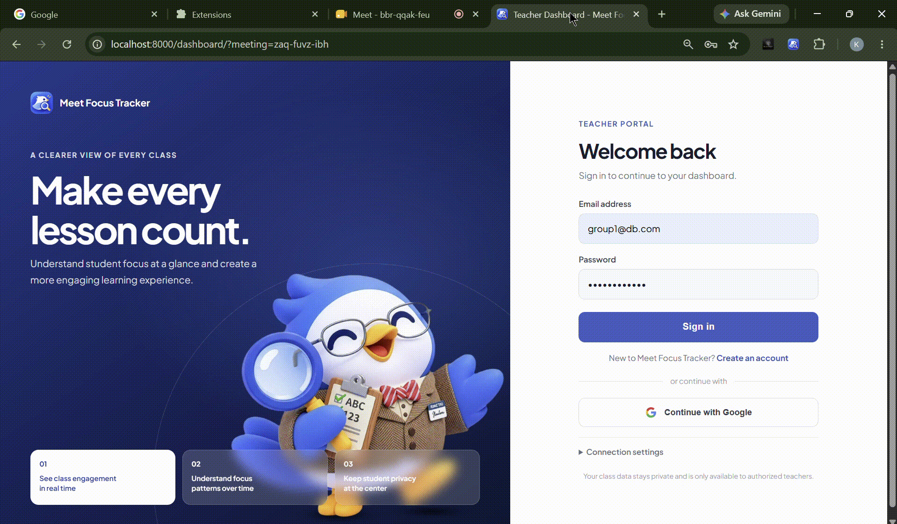

<div align="center">
  
  <h1>WingWatch</h1>
  <p>A privacy-conscious Google Meet focus tracker for participants and teachers.</p>

  
  
  
  
</div>

---

WingWatch is a Chrome extension and teacher dashboard for recording when a participant leaves a Google Meet tab and how long they are away. The participant installs the extension; the teacher uses the dashboard to review results by meeting code.

> **Privacy by design:** WingWatch records focus events and away durations. It does not collect the names of other tabs, browsing activity, or the apps a participant uses.

## Preview



## Features

- Detects when a Google Meet tab becomes hidden or loses focus, including tab switches and minimized browser windows.
- Records leave/return events and calculates time away.
- Requires participants to provide consent before tracking.
- Lets participants view their own results in the extension popup.
- Provides a teacher dashboard with sample data by default and optional Supabase integration.
- Supports Google Meet Picture-in-Picture and treats closing the Meet tab as leaving.

## How it works

1. The extension's content script listens for visibility and focus changes on `meet.google.com`.
2. The background service worker updates local counts and durations and sends focus events to Supabase when configured.
3. The dashboard displays results for a meeting code, using sample data in its default configuration or Supabase when enabled.

```text
Participant's Chrome extension --> Supabase (optional) --> Teacher dashboard
```

## Technology

| Component | Technology |
|---|---|
| Browser extension | Chrome Extension Manifest V3, JavaScript |
| Backend | Supabase (PostgreSQL, REST API, and optional authentication) |
| Dashboard | HTML, CSS, and JavaScript |

## Repository layout

```text
.
├── backend/
│   └── schema.sql             # Supabase tables, policies, and views
├── dashboard/                 # Teacher dashboard and sample events
├── docs/                      # Database, privacy, event, and QA documentation
├── extension/                 # Chrome extension
├── img/                       # Project logo and mascot
├── scripts/
│   └── test-supabase.js        # Optional Supabase connectivity/RLS checks
└── README.md
```

## Getting started

### Install the extension

1. Clone or download this repository.
2. In Chrome, open `chrome://extensions` and enable **Developer mode**.
3. Select **Load unpacked** and choose the repository's `extension` folder.
4. Open Google Meet, click the WingWatch extension, and follow the consent and setup prompts.

The extension's Supabase integration is optional. To configure it, copy `extension/config.example.js` to `extension/config.js` and enter your Supabase project URL and **anon/public** key. Never put a Supabase `service_role` key in the extension or dashboard.

### Run the dashboard locally

The dashboard is a static web app; it does not use `npm install` or `npm start`.

1. (Optional) Copy `dashboard/config.example.js` to `dashboard/config.js`. The example defaults to mock data. To use Supabase, set `BACKEND_PROVIDER` to `"supabase"` and enter your project URL and anon/public key.
2. From the repository root, start a local web server:

   ```bash
   python -m http.server 8000
   ```

3. Open <http://localhost:8000/dashboard/> in your browser.

### Set up Supabase (optional)

1. Create a Supabase project.
2. Run [`backend/schema.sql`](backend/schema.sql) in the Supabase SQL Editor.
3. Configure the extension and dashboard as described above.
4. Configure Supabase authentication and redirect URLs for the dashboard's teacher sign-in flow. Keep row-level security enabled; do not enable anonymous reads on real participant data.

See the [database setup guide](docs/DATABASE.md) for schema details and the optional verification script.

## Event format

Events use a shared JSON schema across the extension, backend, and dashboard:

```json
{
  "participant": "Maria",
  "meetingCode": "abc-defg-hij",
  "type": "left",
  "timestamp": 1760000000000,
  "duration": 30000
}
```

`timestamp` and `duration` are milliseconds; `duration` is present on a returned event. See the [complete event specification](docs/EVENT_FORMAT.md) before changing fields.

## Privacy and limitations

- Tracking starts only after participant consent.
- WingWatch records the participant name, meeting code, event type, timestamp, and away duration. It does not record tab titles, URLs, other apps, screen content, audio, or video.
- Tracking is limited to Google Meet pages; results may be inaccurate in cases such as browser dialogs or other brief focus changes.
- WingWatch cannot determine why someone left Meet, track activity on another device, or guarantee an event is saved if the browser or operating system shuts down unexpectedly.

Read the [privacy statement](docs/PRIVACY.md) for more information.

## Documentation

- [Database and Supabase setup](docs/DATABASE.md)
- [Event format](docs/EVENT_FORMAT.md)
- [Privacy statement](docs/PRIVACY.md)
- [QA test cases](docs/TEST_CASES.md)
- [Paper outline](docs/PAPER_OUTLINE.md)

## Team

| Role | Member |
|---|---|
| Project lead and content script | Kezia Villegas |
| Background script and popup | Francis John Tamayo |
| Backend and integration | Aaron Celindro |
| Dashboard | Francis Conguis |
| UI/UX, QA, and documentation | Janeah Gasis |

**Project date:** October 2026
